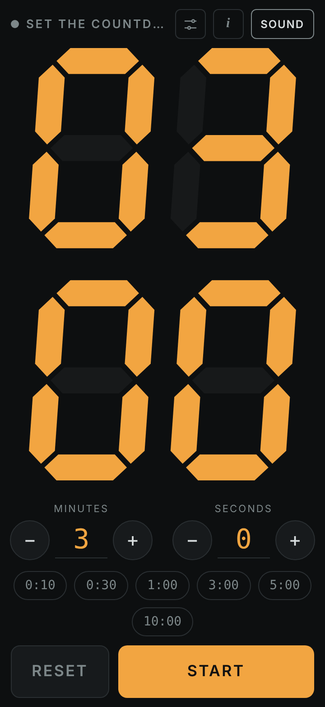
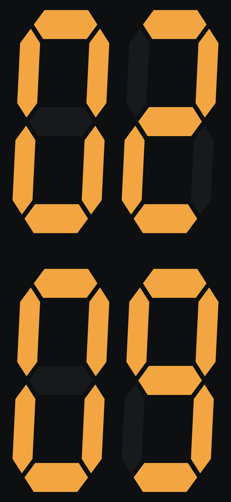
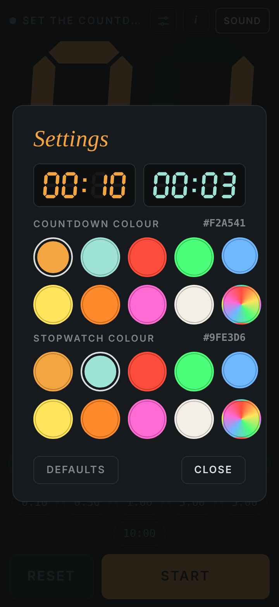
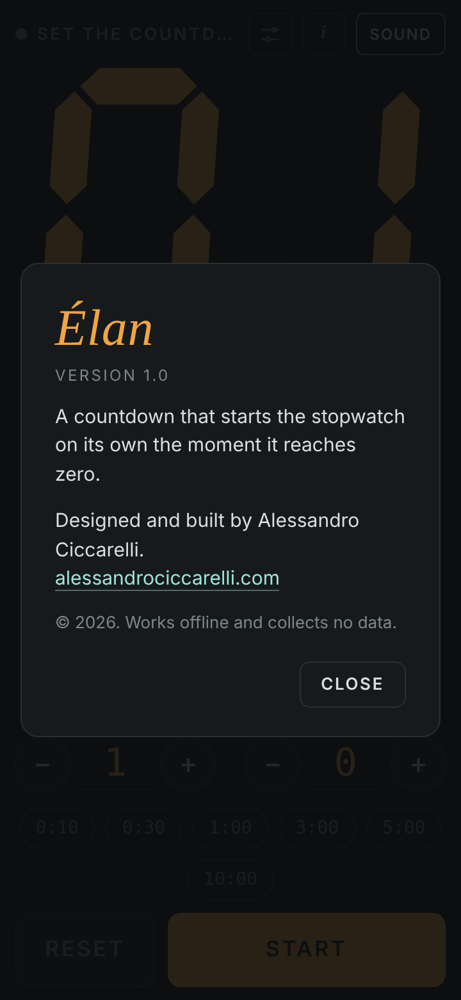
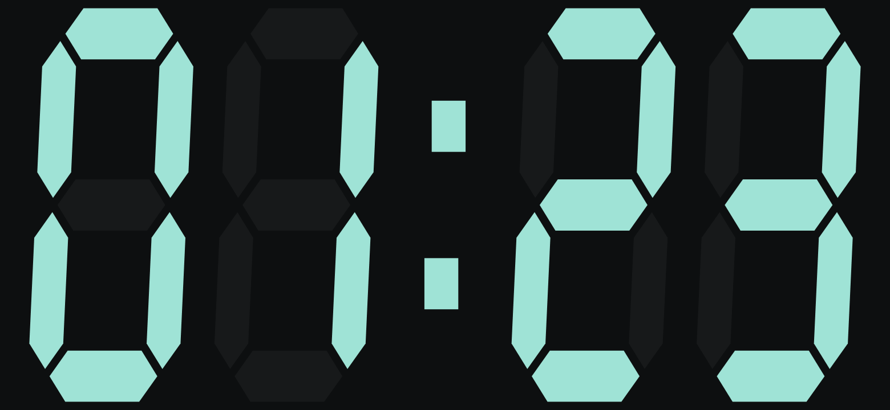

# Élan

Élan is an Android timer that measures time in two consecutive phases. You set a countdown; when it reaches zero, a stopwatch starts on its own. The digits are drawn as seven-segment LED figures and fill the whole screen.

## Screenshots

  
  
  
  

From left: setting the countdown; the countdown running, with minutes above seconds in portrait; colour settings; the About panel.

  
  

In landscape: the countdown in amber, then the stopwatch in aqua once zero has passed.

## Features

- **Countdown, then stopwatch.** Set the duration in minutes and seconds, or pick a preset (0:10, 0:30, 1:00, 3:00, 5:00, 10:00). At zero the app plays a double tone, vibrates and switches to the stopwatch without any input.
- **Full-screen digits.** In portrait, minutes sit above seconds; in landscape they share a single row. Either way they take the full available height.
- **Screen stays on** for as long as the app is open.
- **Works offline.** The app does not request internet access and collects no data.
- **Controls out of the way.** While the time is running only the digits are visible; a tap brings the controls back for four seconds.
- **Colour settings.** Choose the digit colour for the countdown and for the stopwatch, from a palette or freely. The defaults are amber for the countdown and aqua for the stopwatch.
- **About.** The "i" icon on the setup screen shows the version and the author.

Time is always computed from the system clock rather than by counting ticks, so it stays accurate even if the phone slows the app down.

## Installing

Every change pushed to the `main` branch triggers an automatic build, which you can follow in the repository's **Actions** tab. A few minutes later `Elan.apk` appears on the **Releases** page, under the `latest` release.

To install it on your phone:

1. Open the Releases page on the phone and download `Elan.apk`.
2. Open the downloaded file. The first time, Android asks you to allow installs from that source (your browser or file manager): allow it.
3. Google Play Protect may warn that the developer is unknown; choose to install anyway.

To update, download and install the new APK. Your settings are kept.

## Project structure

- `app/src/main/assets/index.html`: the timer itself, meaning the interface, the digit drawing and the timing logic. It also runs in a desktop or mobile browser for quick testing.
- `app/src/main/java/com/ciccarelli/countdown/MainActivity.kt`: the Android window that hosts the timer full screen, keeps the screen on, handles vibration and opens external links in the browser.
- `app/src/main/AndroidManifest.xml`: name, icon, automatic rotation and permissions (vibration only).
- `.github/workflows/build.yml`: the automatic build on GitHub.

## Credits

Designed and built by Alessandro Ciccarelli, [alessandrociccarelli.com](https://alessandrociccarelli.com). 2026.
